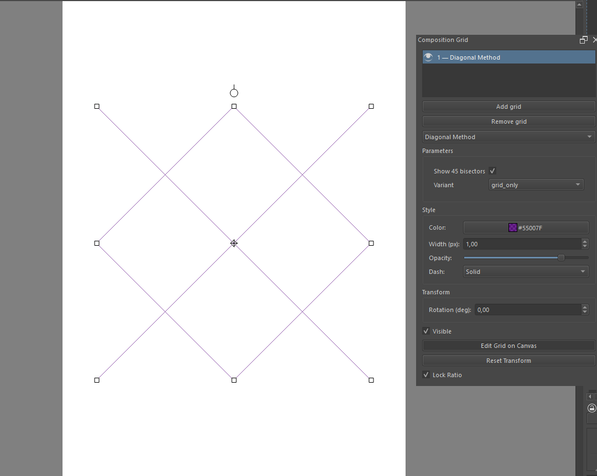
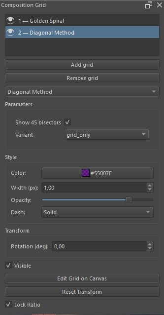

**Русский** | [English](README.en.md)

# Composition Grid — композиционная сетка поверх холста Krita

Трансформируемая сетка-шаблон поверх холста Krita: двигайте, масштабируйте и
поворачивайте композиционную сетку, не трогая сам документ.

[](https://github.com/BloodyRainRage/krita-composition-grid/actions/workflows/ci.yml)
[](https://github.com/BloodyRainRage/krita-composition-grid/releases/latest)


<p align="center"></p>

## Возможности

- **12 типов сеток**: правило третей и пятых, золотое сечение, диагональный
  метод, динамическая симметрия, спираль и золотые треугольники, перспектива и
  другие — с параметрами каждого типа.
- **Несколько сеток на документ**: список в докере, клик по строке — правка
  именно этой сетки, «глаз» — показать/скрыть, двойной клик — переименовать.
- **Прямое взаимодействие на холсте**: перетаскивание за любую точку внутри
  сетки, ресайз за углы и стороны, поворот за верхний маркер, у перспективы —
  перетаскивание точки схода.
- **Неразрушаемость по построению**: сетка — прозрачный виджет **над** вьюпортом, а
  не слой; она не попадает в экспорт, не меняет пиксели и не мешает рисованию,
  когда сеанс правки выключен.
- **Состояние хранится внутри `.kra`** как аннотация файла: открыли документ —
  все его сетки на своих местах; само открытие не помечает файл изменённым
  (а правка сетки — помечает, чтобы её можно было сохранить).
- **Windows и Linux**, Krita 5.3 (PyQt5); код совместим и с PyQt6. **871
  автоматический тест**, встроенная диагностика «почему сетки не видно».

## Требования

| Что | Версия |
|---|---|
| Krita | **5.3+** (вживую проверено на 5.3.1 под Windows; Krita 6.x не проверялась) |
| Python внутри Krita | 3.10–3.13 (встроен в Krita, отдельно ставить не нужно) |
| Зависимости | никаких: только то, что уже есть в Krita (libkis + Qt-привязка) |

Плагин платформенно-независимый. Живая проверка в Krita выполнялась на
Windows; на Linux автоматические тесты гоняет CI, живой прогон в Krita на
Linux и macOS пока не делался.

## Установка

Самый простой путь — готовый архив из Releases.

1. Скачайте `composition_grid-<version>.zip` со
   [страницы последних релизов](https://github.com/BloodyRainRage/krita-composition-grid/releases/latest).
2. В Krita: **Tools ▸ Scripts ▸ Import Python Plugin from File…** и выберите
   архив.
3. **Settings ▸ Configure Krita… ▸ Python Plugin Manager**: включите
   **Composition Grid**, OK.
4. **Перезапустите Krita** — без перезапуска панель и меню-команды не появятся.
5. Панель: **Settings ▸ Dockers ▸ Composition Grid**.

### Куда копировать руками

Архив (или папку из него) можно распаковать и вручную: файл
`composition_grid.desktop` и папка `composition_grid/` должны лежать **рядом**,
в корне `pykrita`:

| ОС | Каталог `pykrita` |
|---|---|
| Windows | `%APPDATA%\krita\pykrita\` |
| Linux (deb/AppImage) | `~/.local/share/krita/pykrita/` |
| Linux (Flatpak) | `~/.var/app/org.kde.krita/data/krita/pykrita/` |
| macOS (не тестировалось) | `~/Library/Application Support/krita/pykrita/` |

### После установки

Команды плагина — в **Tools ▸ Scripts**: *Add Composition Grid*, *Toggle
Composition Grid*, *Remove Composition Grid*, *Toggle Grid Edit Session*,
*Reset Grid Transform*, *Cycle Grid Type*. Горячие клавиши по умолчанию не
назначены — задайте их в **Settings ▸ Configure Krita… ▸ Keyboard Shortcuts**.

## Как пользоваться



- **Add grid** — добавить сетку в текущий документ (или **Tools ▸ Scripts ▸ Add
  Composition Grid**). Новый чистый холст не содержит ни одной сетки: сетка
  появляется только по вашему действию.
- **Клик по строке списка** — выбрать сетку; она сразу открывается на холсте для
  правки (маркеры появляются без дополнительных кнопок).
- **Перетащить внутри сетки** — перенос; **угловые и сторонние маркеры** —
  resize; **маркер над верхней серединой** — поворот вокруг центра.
- **Shift** при ресайзе за угол временно инвертирует «Lock Ratio».
- **Глаз** слева от строки — показать/скрыть эту сетку (скрытая сетка остаётся в
  документе); **Remove** — удалить выбранную сетку вместе с её параметрами.
- **Двойной клик** (или F2) по строке — переименовать метку сетки.
- **Выход из режима правки**: клик мимо сетки и её маркеров, повторное нажатие
  «Edit Grid on Canvas» или команда *Toggle Grid Edit Session*. Вне этого режима
  сетка не перехватывает ни одного клика — рисовать можно как обычно.
- Стиль (цвет, толщина, прозрачность, пунктир) и параметры типа — в докере,
  применяются сразу. Толщина задаётся в пикселях экрана, поэтому не зависит от зума.
- **↺** справа от параметра возвращает его значение по умолчанию; **Reset
  parameters** сбрасывает все параметры выбранной сетки (стиль и положение не
  трогает).
- Всё состояние сохраняется **в самом `.kra`**: файл с сетками открывается с тем
  же списком, выбором и трансформациями.

<br clear="right">

## 12 типов сеток

| Тип в докере | Что рисует |
|---|---|
| **Rule of Thirds** | две вертикали и две горизонтали на 1/3 и 2/3 плюс четыре точки силы |
| **Center Cross** | центральный крест; вертикаль, горизонталь и центральная точка включаются по отдельности |
| **Quadrant Grid** | центральный крест плюс (по желанию) четыре точки в центрах квадрантов |
| **Golden Ratio (Phi)** | линии на 1/φ и 1−1/φ по обеим осям и четыре точки пересечения |
| **Rule of Fifths** | по четыре вертикали и горизонтали, делящих элемент на пять равных полос |
| **Uniform Grid** | равномерная сетка: `columns` × `rows` (1…24) с параметром `margin` |
| **Symmetry Axes** | 1…4 вертикальные и 1…4 горизонтальные оси, зеркально относительно центра |
| **Golden Spiral** | спираль из шести золотых прямоугольников, вписанная во всю рамку; угол старта — `origin` |
| **Golden Triangles** | диагональ плюс перпендикуляры из двух вершин, не лежащих на ней |
| **Diagonal Method** | диагонали из всех четырёх углов и лучи под 45° из середин длинных сторон |
| **Dynamic Symmetry** | root-прямоугольник √2/√3/√5, его стороны, диагонали и reciprocals Hambidge |
| **Perspective** | одна точка схода, лучи к равномерным делениям всех четырёх краёв (как у сетки пола и стен) и горизонт |

## Сборка из исходников

Нужен [uv](https://docs.astral.sh/uv/); для работы в Krita сборка не требуется
вообще.

```powershell
# Windows (PowerShell)
git clone https://github.com/BloodyRainRage/krita-composition-grid.git
cd krita-composition-grid
uv sync
uv run python tools\build_plugin_zip.py
uv run pytest -q
```

```sh
# Linux / macOS
git clone https://github.com/BloodyRainRage/krita-composition-grid.git
cd krita-composition-grid
uv sync
uv run python tools/build_plugin_zip.py
uv run pytest -q
```

`uv sync` ставит dev-зависимости (`pytest` и `PyQt6`), поэтому Qt-тесты
исполняются, а не пропускаются; артефакт ляжет в `dist/composition_grid-<version>.zip`.
Тесты требуют `QT_QPA_PLATFORM=offscreen` (в CI выставляется автоматически; часть
Qt-тестов ставит его сама).

### Установка из исходников без сборки архива

```powershell
# Windows: цель по умолчанию — %APPDATA%\krita\pykrita
powershell -ExecutionPolicy Bypass -File .\tools\install.ps1
```

```sh
# Linux: цель по умолчанию — $HOME/.local/share/krita/pykrita
sh tools/install.sh

# Flatpak-профиль Krita — укажите цель первым аргументом
sh tools/install.sh "$HOME/.var/app/org.kde.krita/data/krita/pykrita"
```

Оба скрипта копируют ровно `composition_grid.desktop` и пакет `composition_grid/`
(без `__pycache__` и `*.pyc`), ничего не удаляют и печатают список скопированных
файлов. После копирования — включить плагин в Python Plugin Manager и
перезапустить Krita. При обновлении «поверх» старой версии осиротевшие файлы
нужно удалить вручную: скрипты намеренно ничего не удаляют.

## Лицензия

GPL-3.0-or-later. Полный текст — в [`LICENSE`](LICENSE).
